# Despliegue de PokeDex en Azure (App Service) con CI/CD y DevSecOps

Aplicación: **PokeDex** (Angular 14), repositorio https://github.com/jetbill/pokedex
Producción: https://app-pokedex-monterrey-prod.azurewebsites.net
Motor de CI/CD: **Azure Pipelines** (Azure DevOps, organización `wrenteriaSolutions`, proyecto `pokedex-pipeline`).

 

---

## 1. Arquitectura y recursos

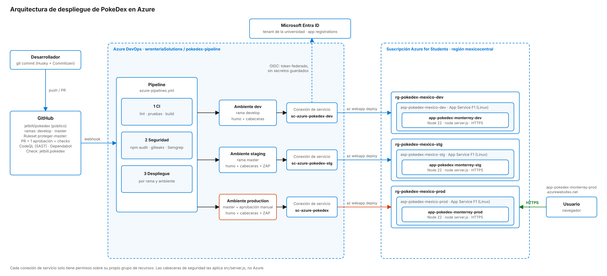

*GitHub dispara Azure Pipelines. El pipeline despliega a cada ambiente con una conexión de servicio OIDC limitada a su grupo de recursos, y el usuario accede a producción por HTTPS.*

### 1.1 Por qué App Service y no Static Web Apps
La suscripción tiene una política de Azure que solo permite las regiones `francecentral`, `chilecentral`, `canadacentral`, `belgiumcentral` y `mexicocentral`. Azure Static Web Apps no está disponible en esas regiones (la creación falló con `RequestDisallowedByAzure`). Se usa **Azure App Service, plan F1 (gratuito), Linux, Node 22 LTS**, en `mexicocentral`.

### 1.2 Cómo se sirve la aplicación
La aplicación se compila a archivos estáticos. Un servidor Node sin dependencias (`src/server.js`, copiado a la carpeta de salida durante el build) los sirve y se encarga de:

- Redirección de rutas de la SPA a `index.html` (las rutas con extensión que no existen devuelven 404).
- Cabeceras de seguridad (sección 6).
- Compresión gzip y cabeceras de caché (archivos con hash: `immutable`; `index.html`: `no-cache`).
- Solo métodos GET y HEAD, protección contra *path traversal* y el endpoint de salud `/healthz`.

Comando de inicio de la aplicación: `node server.js`.

### 1.3 Recursos por ambiente

| Ambiente | Rama | Grupo de recursos | Plan | Aplicación web | Conexión de servicio |
|---|---|---|---|---|---|
| dev | `develop` | `rg-pokedex-mexico-dev` | `asp-pokedex-mexico-dev` | `app-pokedex-monterrey-dev` | `sc-azure-pokedex-dev` |
| staging | `master` | `rg-pokedex-mexico-stg` | `asp-pokedex-mexico-stg` | `app-pokedex-monterrey-stg` | `sc-azure-pokedex-stg` |
| production | `master` (con aprobación) | `rg-pokedex-mexico-prod` | `asp-pokedex-mexico-prod` | `app-pokedex-monterrey-prod` | `sc-azure-pokedex` |

Convención de nombres: `[prefijo]-[proyecto]-[ubicación]-[entorno]`, según el documento de buenas prácticas del docente (`rg` grupo de recursos, `asp` plan, `app` aplicación web, `sc` conexión de servicio).

Configuración de seguridad de cada aplicación: solo HTTPS, TLS mínimo 1.2, FTP deshabilitado, afinidad de cliente deshabilitada y `SCM_DO_BUILD_DURING_DEPLOYMENT=false` (el pipeline entrega el build ya compilado).

### 1.4 Servicios de Azure utilizados y por qué se eligieron

| Servicio | Qué es | Función en este proyecto | Por qué se eligió | Notas |
|---|---|---|---|---|
| **Tenant** | Instancia dedicada de Microsoft Entra de una organización. Es el directorio que contiene usuarios, grupos y aplicaciones. | Es el tenant de la universidad (Fundación Universitaria Tecnológico Comfenalco). La cuenta institucional vive en él y la suscripción Azure for Students cuelga de él. | No se eligió: viene impuesto por la cuenta de estudiante. | Al ser de la universidad, el panel de administración está restringido (error 401 en Entra). Las políticas, como la de regiones permitidas, las define la universidad. |
| **Microsoft Entra ID** | Servicio de identidad y acceso en la nube (antes Azure Active Directory). Gestiona usuarios, autenticación, MFA, permisos y registros de aplicaciones. | Autentica el inicio de sesión en Azure y Azure DevOps y aplica el MFA. Aloja los registros de aplicación que usan las conexiones de servicio. | Es el sistema de identidad de Azure y no tiene alternativa. | El MFA se configuró desde mysignins.microsoft.com porque el panel de Entra estaba bloqueado. |
| **Organización de Azure DevOps** (`wrenteriaSolutions`) | Contenedor de nivel superior de Azure DevOps. Agrupa proyectos, usuarios, facturación y permisos. | Es el espacio donde viven el proyecto, el pipeline, los ambientes y las conexiones de servicio. | Es requisito para usar Azure Pipelines, el motor de CI/CD elegido. | Los agentes de Microsoft son gratuitos en proyectos privados (1 trabajo paralelo, 1800 minutos al mes). |
| **Proyecto de Azure DevOps** (`pokedex-pipeline`) | Espacio de trabajo dentro de la organización con sus propios pipelines, ambientes, conexiones de servicio y permisos. | Contiene el pipeline `azure-pipelines.yml`, los ambientes dev, staging y production y las conexiones de servicio. | Aísla todo lo de PokeDex y permite controlar su visibilidad. | Debe ser **Privado** para tener minutos gratuitos. El repositorio de GitHub puede seguir siendo público: el pipeline lo lee desde GitHub. |
| **Azure Static Web Apps** | Servicio de Azure para hospedar sitios estáticos y SPAs, con CDN global, HTTPS y APIs opcionales. | **No se usó.** Era la opción inicial para servir el build de Angular. | Encaja con una SPA y tiene plan gratuito. | La política de regiones de la universidad lo impidió: solo permite `francecentral`, `chilecentral`, `canadacentral`, `belgiumcentral` y `mexicocentral`, y Static Web Apps no está en ninguna. La creación falló con `RequestDisallowedByAzure`. |
| **Grupos de recursos** (`rg-pokedex-mexico-prod`, `-stg`, `-dev`) | Contenedor lógico que agrupa recursos de Azure relacionados. | Cada ambiente tiene el suyo, con su plan y su aplicación web. | Aísla los ambientes y permite dar permisos por separado: cada conexión de servicio solo ve su grupo. Borrar un grupo elimina todo lo que contiene. | No tienen costo. Siguen la convención de nombres del docente. |
| **Planes de App Service** (`asp-pokedex-mexico-*`) | Define la capacidad de cómputo (región, sistema operativo y tamaño) sobre la que corren una o más aplicaciones web. | Aloja las aplicaciones. Es F1 (gratuito) en Linux, en `mexicocentral`. | Es gratuito y está en una región permitida. | F1 tiene cuota diaria de CPU, arranque en frío de uno o dos minutos y no tiene slots de despliegue. |
| **Aplicaciones web** (`app-pokedex-monterrey-*`) | Servicio de App Service que ejecuta aplicaciones web con un runtime gestionado. | Ejecuta `server.js` (Node 22 LTS), que sirve el Angular compilado con las cabeceras de seguridad. Cada ambiente tiene su URL HTTPS. | Reemplazó a Static Web Apps y ofrece HTTPS gestionado sin administrar servidores. Un servidor Node propio permitió controlar las cabeceras y obtener A+. | Configuradas con solo HTTPS, TLS 1.2 mínimo, FTP deshabilitado y despliegue por zip. |
| **Conexiones de servicio** (`sc-azure-pokedex-*`) | Recurso de Azure DevOps que guarda cómo autenticarse contra un servicio externo, aquí Azure Resource Manager. | Permite al pipeline desplegar en Azure sin contraseñas, mediante federación de identidades (OIDC). | No hay secretos que filtrar ni rotar y cada conexión se limita a un grupo de recursos. Cumple el requisito de no dejar credenciales en el repositorio. | Una por ambiente. Cada una crea un registro de aplicación en Entra, aunque el panel de administración esté restringido. |

**Relación entre ellos:** el tenant contiene la identidad (Entra ID) y la suscripción. En Azure DevOps, la organización contiene el proyecto, y el proyecto contiene el pipeline y las conexiones de servicio. Cada conexión autentica contra un grupo de recursos, que contiene un plan de App Service y una aplicación web.

---

## 2. Despliegue manual inicial [MANUAL]

Requisitos: Azure CLI con sesión iniciada (`az login`), Node 18 o superior y npm. Los comandos son para **PowerShell**; las variables de ejemplo corresponden al ambiente de producción.

### 2.1 Crear la infraestructura
```powershell
$RG   = "rg-pokedex-mexico-prod"
$PLAN = "asp-pokedex-mexico-prod"
$APP  = "app-pokedex-monterrey-prod"
$LOC  = "mexicocentral"

az group create --name $RG --location $LOC

az appservice plan create --name $PLAN --resource-group $RG --location $LOC --sku F1 --is-linux

az webapp create --name $APP --resource-group $RG --plan $PLAN --runtime "NODE:22-lts"

az webapp update --name $APP --resource-group $RG --https-only true --client-affinity-enabled false

az webapp config set --name $APP --resource-group $RG --startup-file "node server.js" --min-tls-version 1.2 --ftps-state Disabled

az webapp config appsettings set --name $APP --resource-group $RG --settings SCM_DO_BUILD_DURING_DEPLOYMENT=false
```

### 2.2 Compilar y empaquetar
```powershell
npm ci
npx ng build --configuration production
tar -a -c -f app.zip -C dist/pokedex-angular .
```

El contenido de `dist/pokedex-angular` debe incluir `index.html` y `server.js`.

### 2.3 Desplegar
```powershell
az webapp deploy --resource-group $RG --name $APP --src-path app.zip --type zip
```

### 2.4 Verificar
```powershell
curl.exe -s https://$APP.azurewebsites.net/healthz
curl.exe -sI https://$APP.azurewebsites.net/
```

Debe responder `ok` en `/healthz` y mostrar las cabeceras de la sección 6.

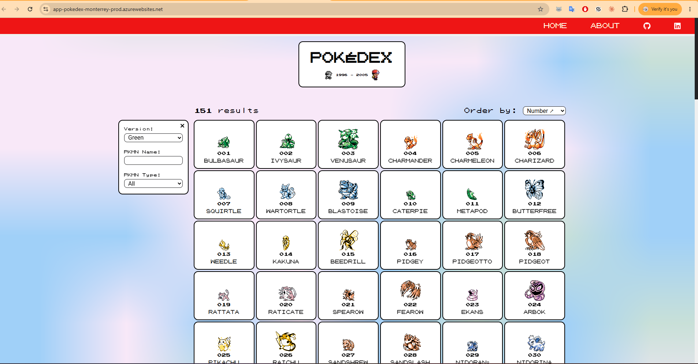

La única configuración de la aplicación web es `SCM_DO_BUILD_DURING_DEPLOYMENT=false`:

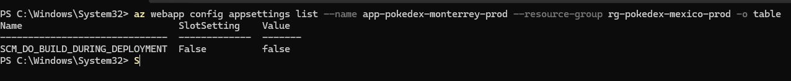

> La primera petición tras un periodo sin tráfico puede tardar uno o dos minutos (plan F1).

---

## 3. Pipeline de CI/CD [AUTO]

Archivos: `azure-pipelines.yml`, `azure-pipelines/templates/deploy-env.yml`, `scripts/smoke-test.sh`, `scripts/verify-headers.sh` (contenido completo en los anexos A a D).

### 3.1 Disparadores y flujo

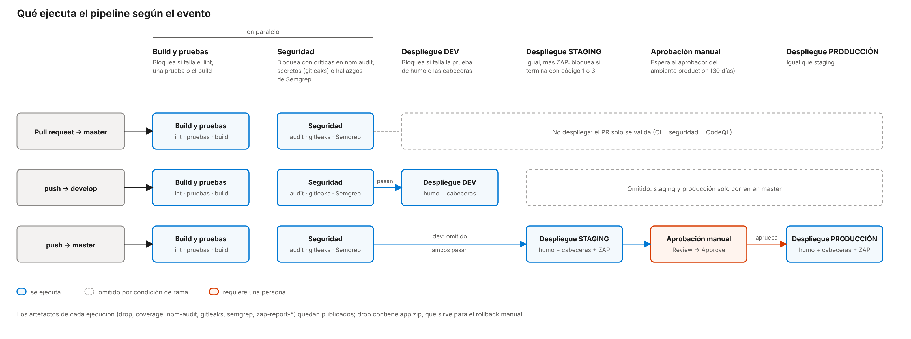

*Un pull request solo valida. `develop` despliega a dev. `master` despliega a staging y, tras la aprobación manual, a producción.*

| Evento | Qué ejecuta |
|---|---|
| Pull request hacia `master` | Build (lint, pruebas, build) y Seguridad. No despliega |
| Push a `develop` | Build y Seguridad, despliegue a **dev** y pruebas posteriores |
| Push a `master` | Build y Seguridad, despliegue a **staging** y pruebas posteriores con ZAP; después **aprobación manual** y despliegue a **producción** con pruebas posteriores y ZAP |

### 3.2 Etapas

| Etapa | Contenido |
|---|---|
| **CI: dependencias, lint, pruebas y build** | `npm ci`, `npm run lint`, pruebas unitarias con cobertura en Chrome headless, `ng build --configuration production`, empaquetado en `app.zip`. Publica los artefactos `drop` y `coverage` |
| **Seguridad previa al despliegue** (en paralelo con CI) | `npm audit` (informe y puerta: falla con vulnerabilidades **críticas** en dependencias de producción), **gitleaks** sobre todo el historial (falla si encuentra secretos), **Semgrep** (reglas JavaScript y TypeScript, falla si hay hallazgos). Publica `npm-audit`, `gitleaks` y `semgrep` |
| **Despliegue a DEV / STAGING / PRODUCCIÓN** | Descarga `drop`, ejecuta `az webapp deploy --type zip` con la conexión de servicio del ambiente |
| **Pruebas posteriores** | `smoke-test.sh` (salud, portada, ruta profunda, 404, HTTP a HTTPS), `verify-headers.sh` (cabeceras), y en staging y producción **OWASP ZAP baseline** (artefacto `zap-report-<ambiente>`) |

Además, **CodeQL** (análisis estático de GitHub, configuración predeterminada) y **Dependabot** (alertas, actualizaciones de seguridad y `.github/dependabot.yml` para actualizaciones de versiones) corren dentro de GitHub.

### 3.3 Secretos y credenciales
- No hay contraseñas, claves ni tokens en el repositorio.
- El despliegue se autentica con **conexiones de servicio de Azure con federación de identidades de carga de trabajo (OIDC)**, una por ambiente y limitada a su grupo de recursos.
- El único archivo de configuración con valores sensibles posibles sería `appsettings` de la aplicación web, que no se versiona.

### 3.4 Configuración [MANUAL] necesaria una sola vez

1. **Azure DevOps → Pipelines → New pipeline**: origen GitHub, repositorio `jetbill/pokedex`, *Existing Azure Pipelines YAML file*, ruta `/azure-pipelines.yml`.
2. **Environments**: crear `dev`, `staging` y `production`. En `production`, agregar el check **Approvals** (todos los aprobadores deben aprobar, tiempo límite de 30 días).
3. **Service connections**: crear `sc-azure-pokedex-dev`, `sc-azure-pokedex-stg` y `sc-azure-pokedex` (Azure Resource Manager, *App registration automatic*, *Workload identity federation*, alcance al grupo de recursos).
4. En la primera ejecución, pulsar **Permit** cuando el pipeline pida permiso para usar conexiones y ambientes.
5. Proyecto de Azure DevOps en modo **Privado** para usar los minutos gratuitos de agentes de Microsoft (1 trabajo paralelo, 1800 minutos al mes). **[COMPLETAR: verificar en Project settings → Overview que el proyecto es Private]**
6. **GitHub → Settings → Rules → Rulesets**, regla `proteger-master`:
   - Aplica a la rama predeterminada (`master`).
   - Requiere pull request antes de fusionar, con 1 aprobación.
   - Requiere checks de estado: `jetbill.pokedex` (Azure Pipelines) y `Analyze (javascript-typescript)` (CodeQL).
   - Restringe el borrado de la rama y bloquea los force push.
   - Lista de bypass: *Repository admin*.
7. **GitHub → Settings → Advanced Security**: Dependabot alerts y security updates activados, CodeQL en configuración predeterminada.

Evidencia de la configuración:

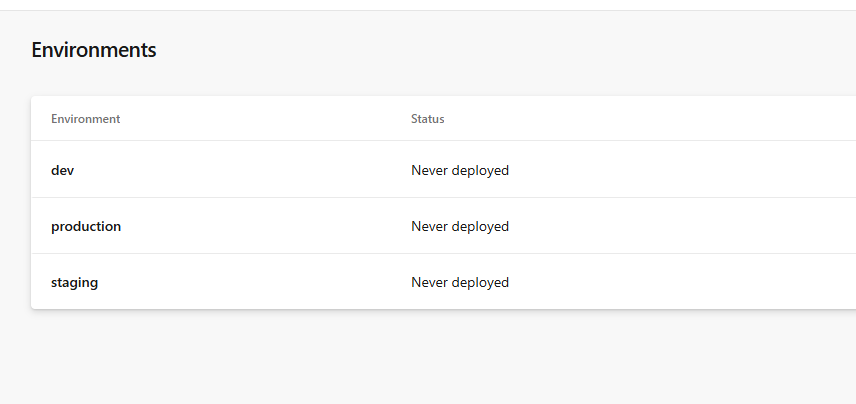

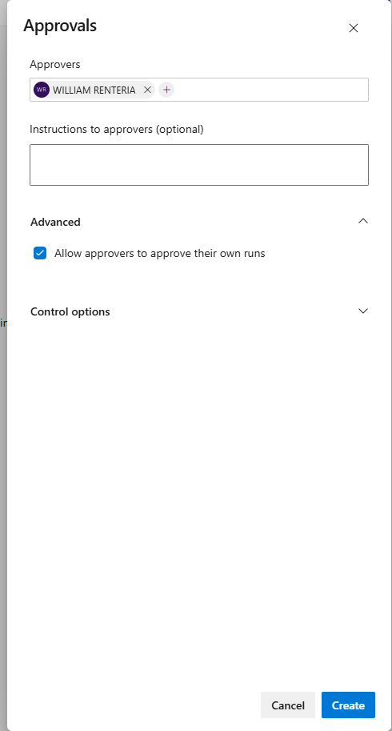

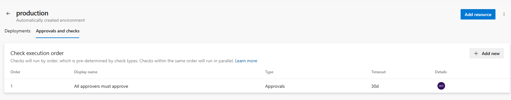

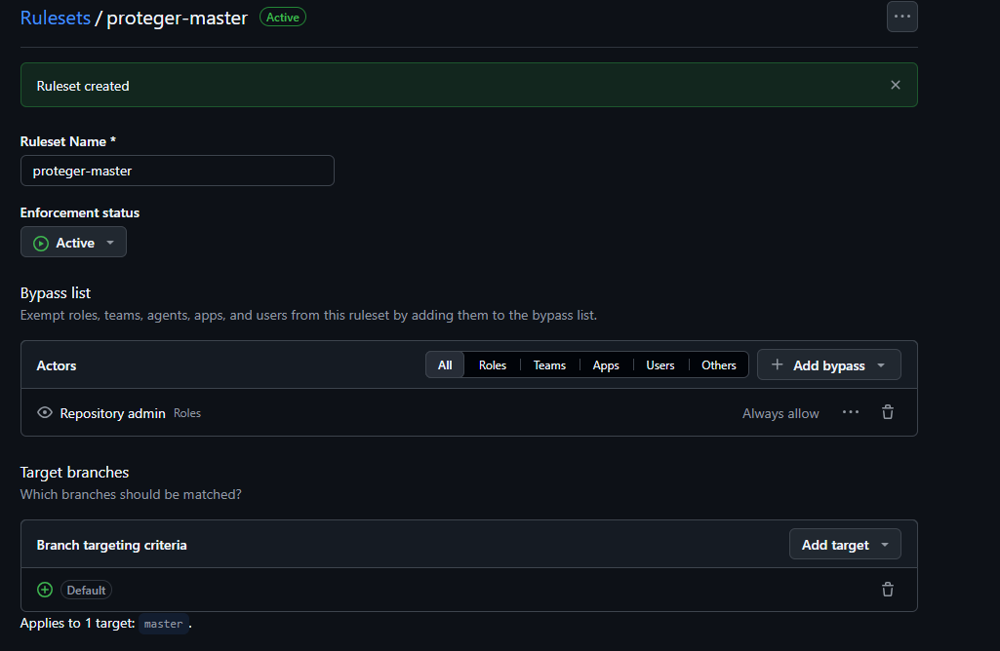

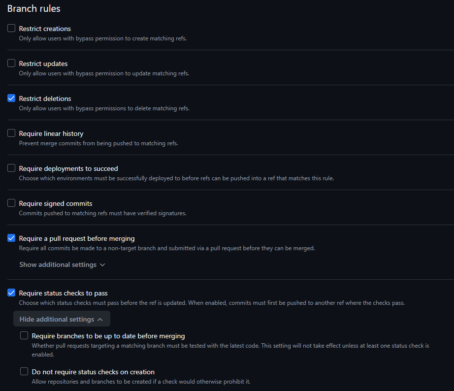

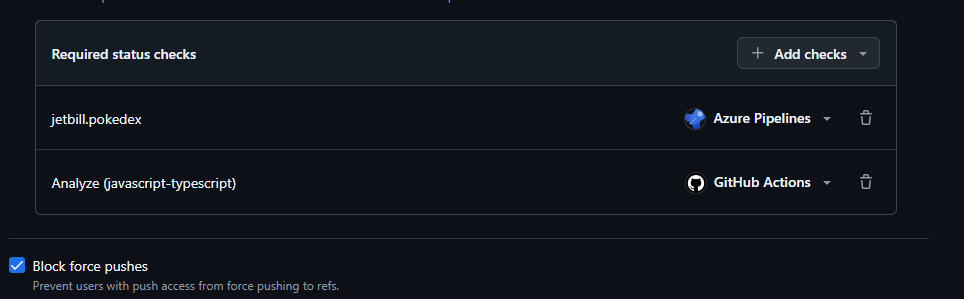

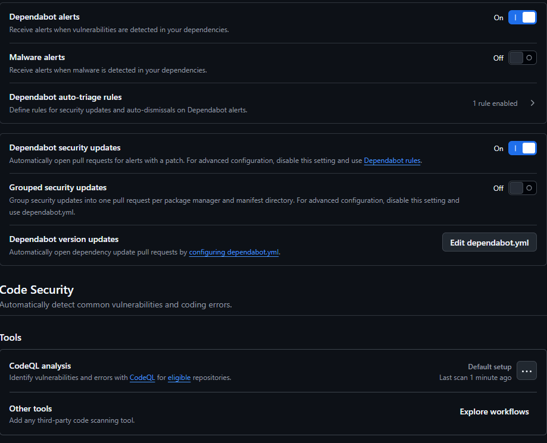

### 3.5 Ejecuciones de verificación

| Ejecución | Resultado |
|---|---|
| Push a `develop` (commit `874521b`) | CI 3 min 7 s, Seguridad 4 min 42 s, DEV 2 min 22 s, todo en verde; staging y producción omitidos por condición |
| Push a `master` (merge del PR #12) | CI y Seguridad en verde, staging con ZAP en verde, producción tras aprobación manual en verde |

Ejecución sobre `develop`: CI, Seguridad y despliegue a dev en verde; staging y producción omitidos.

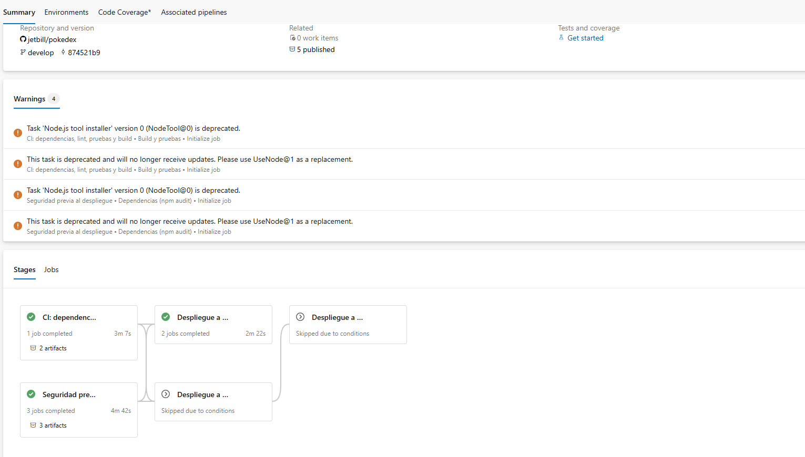

Pruebas posteriores en dev:

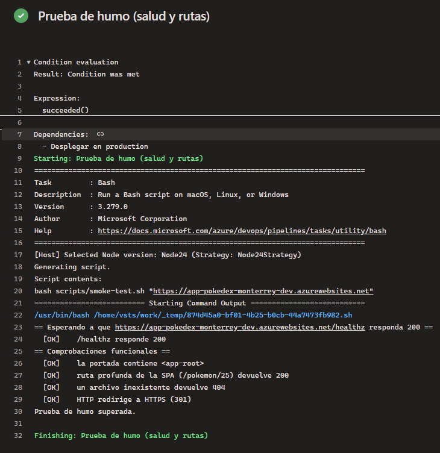

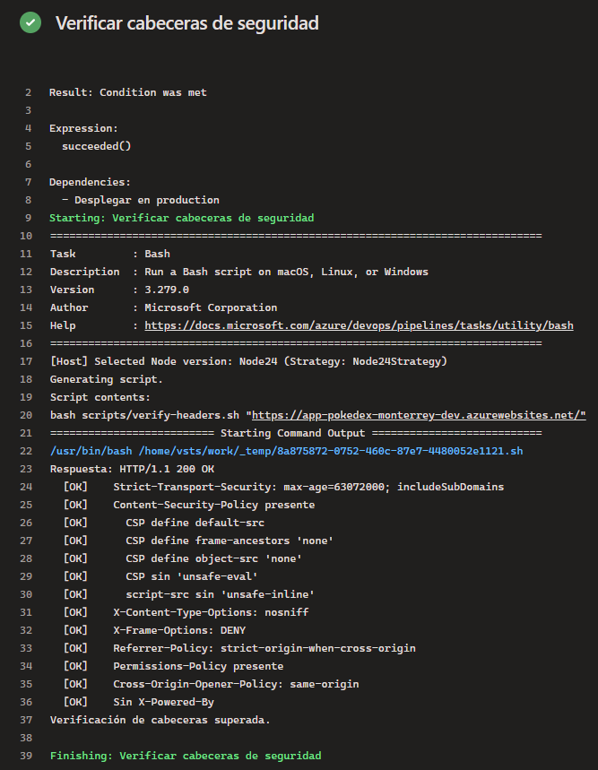

Pull request #12 de `develop` a `master`: la regla exige 1 aprobación mientras los checks se ejecutan.

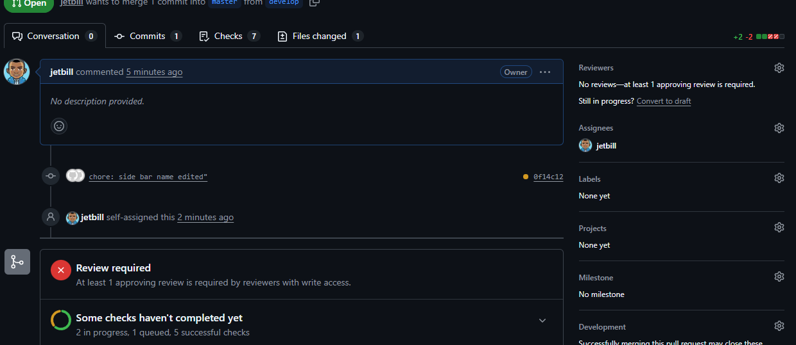

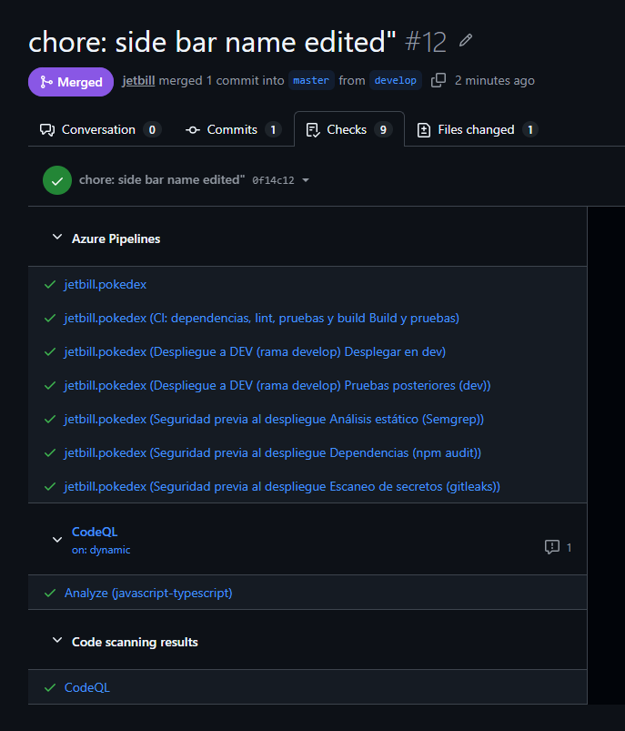

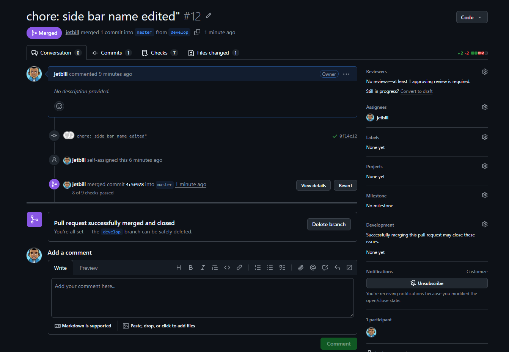

Ejecución sobre `master`: producción espera la aprobación manual y luego se despliega.

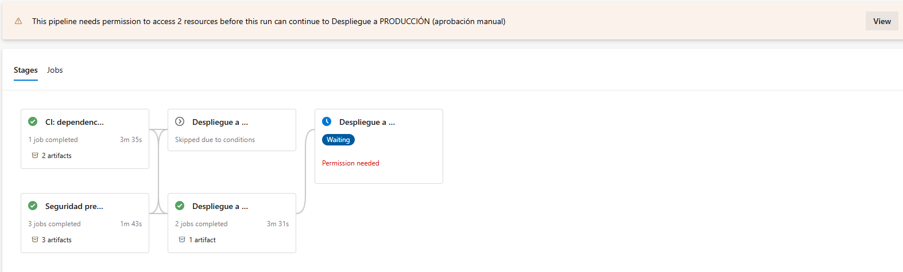

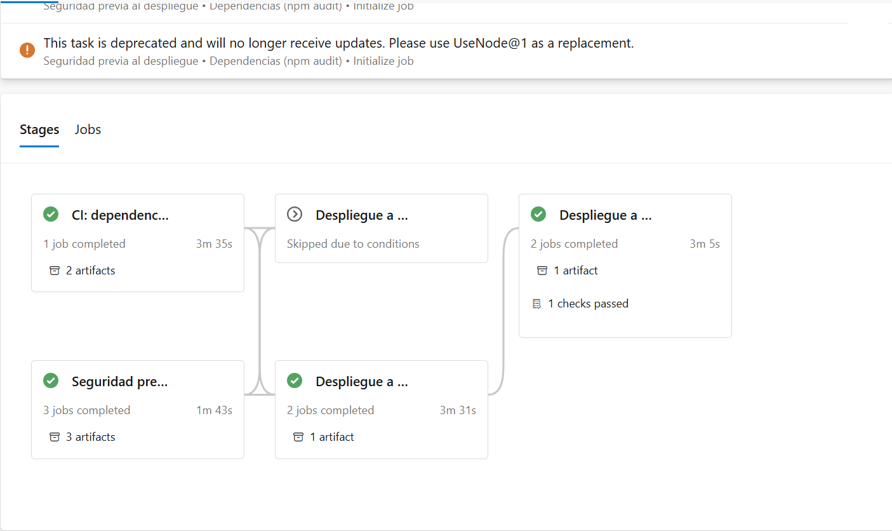

### 3.6 Flujo de trabajo diario
1. Crear una rama de trabajo y un commit (el repositorio usa Husky, lint-staged y Commitizen: formato de mensaje convencional).
2. Fusionar a `develop` o abrir un PR: se ejecuta CI y Seguridad; `develop` despliega a dev.
3. Abrir un PR de `develop` a `master`. Los checks requeridos deben pasar y se necesita 1 aprobación. El propietario del repositorio puede usar el bypass de administrador, y debe quedar documentado como excepción consciente.
4. Al fusionar a `master`: staging se despliega solo; producción espera la aprobación manual en Azure DevOps (**Review → Approve**).

---

## 4. Rollback

El plan F1 **no tiene slots de despliegue**, así que no hay intercambio instantáneo de versiones. Hay dos caminos.

### 4.1 Rollback por Git (recomendado) [MANUAL + AUTO]
1. Identificar el commit o el merge que causó el problema.
2. Crear una rama y revertirlo:
   ```powershell
   git checkout master
   git pull
   git checkout -b fix/rollback-<descripcion>
   git revert <sha-del-commit-o-merge>
   git push -u origin fix/rollback-<descripcion>
   ```
   Para un merge commit se agrega `-m 1`.
3. Abrir el PR hacia `master` y fusionarlo (checks, aprobación o bypass de administrador).
4. **[AUTO]** El pipeline recorre CI, Seguridad, staging con pruebas y la aprobación manual de producción. La versión anterior vuelve a producción.

### 4.2 Rollback manual con un artefacto anterior (emergencia) [MANUAL]
Úsalo cuando no hay tiempo de esperar al pipeline completo.

1. En Azure DevOps, abrir una ejecución anterior que estuvo en verde en producción, ir a **Related → published** y descargar el artefacto `drop` (contiene `app.zip`).
2. Desplegarlo:
   ```powershell
   az login
   az webapp deploy --resource-group rg-pokedex-mexico-prod --name app-pokedex-monterrey-prod --src-path .\app.zip --type zip
   ```
3. Verificar:
   ```powershell
   curl.exe -s https://app-pokedex-monterrey-prod.azurewebsites.net/healthz
   ```
4. Después, corregir `master` con el procedimiento 4.1 para que el repositorio y producción vuelvan a coincidir.

> Los artefactos de las ejecuciones se conservan solo durante el tiempo de retención configurado en Azure DevOps. **[COMPLETAR: retención vigente]**

---

## 5. Seguridad: resumen

| Control | Herramienta | Momento | Efecto |
|---|---|---|---|
| Dependencias vulnerables | `npm audit`, Dependabot | Pipeline y GitHub | Falla con críticas en producción; alertas y PRs automáticos |
| Secretos en el código | gitleaks (historial completo) | Antes del despliegue | Falla si encuentra secretos |
| SAST | Semgrep y CodeQL | Antes del despliegue y en GitHub | Falla en Semgrep; CodeQL requerido en el PR |
| Cabeceras de seguridad | `verify-headers.sh` | Después de cada despliegue | Falla si falta o es débil una cabecera |
| DAST | OWASP ZAP baseline | Después del despliegue a staging y producción | Informe; falla ante errores del escaneo |
| Protección de rama | Ruleset de GitHub | En el PR | PR, aprobación y checks obligatorios |

---

## 6. Cabeceras de seguridad (securityheaders.com)

Resultado medido en https://securityheaders.com:

| Momento | Sitio | Nota |
|---|---|---|
| Antes (cabeceras desactivadas temporalmente en laboratorio) | https://app-pokedex-monterrey-prod.azurewebsites.net (26 oct 2026, 21:46 UTC) | **F** |
| Después | el mismo sitio con las cabeceras activas (26 oct 2026, 22:04 UTC) | **A+** |
| Verificación final, tras el despliegue por el pipeline | el mismo sitio (27 oct 2026, 19:37 UTC) | **A+** |

Antes (F):

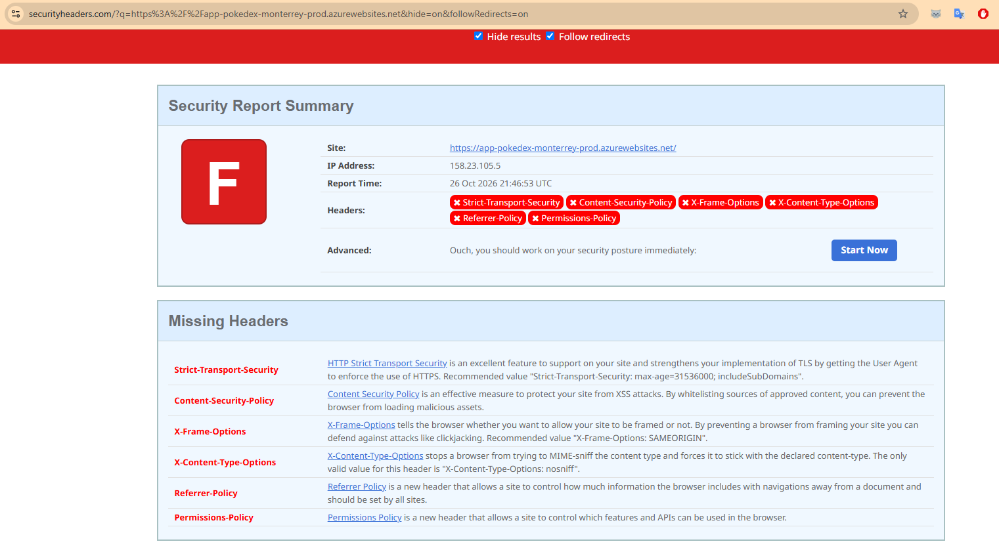

Después (A+):

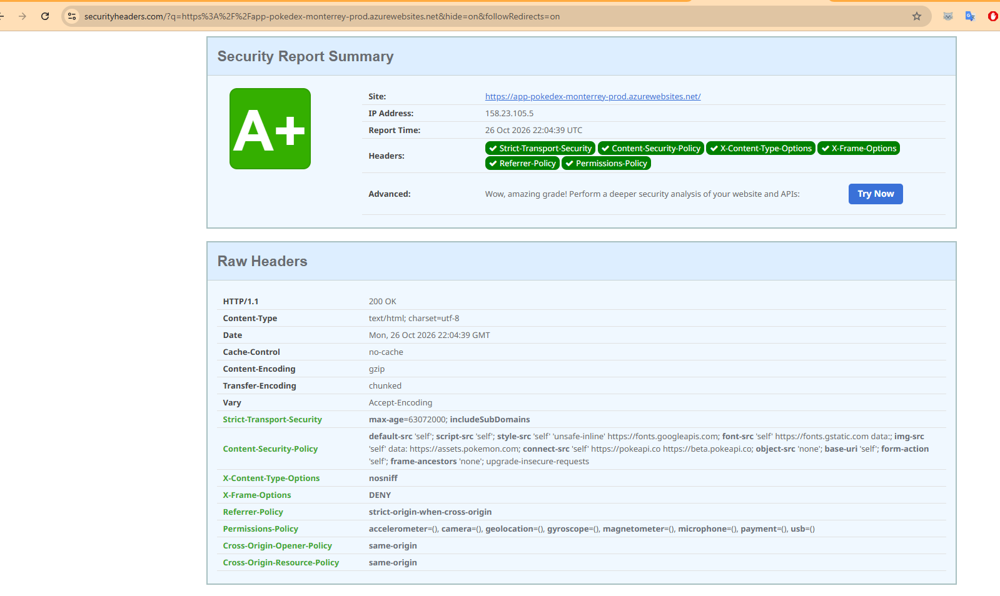

Verificación final tras el despliegue del pipeline (A+):

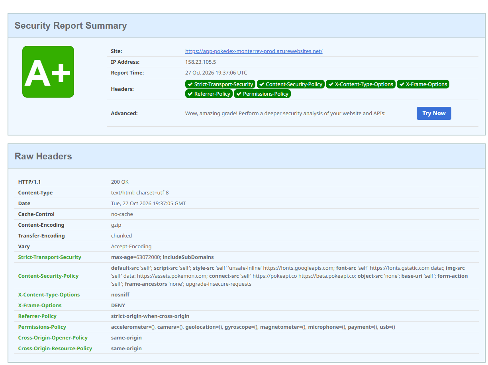

Las cabeceras se aplican en `src/server.js` (objeto `SECURITY_HEADERS`) y se envían en todas las respuestas. No dependen de la configuración de Azure.

| Cabecera | Valor | Para qué sirve |
|---|---|---|
| `Strict-Transport-Security` | `max-age=63072000; includeSubDomains` | Obliga al navegador a usar siempre HTTPS durante 2 años |
| `Content-Security-Policy` | `default-src 'self'; script-src 'self'; style-src 'self' 'unsafe-inline' https://fonts.googleapis.com; font-src 'self' https://fonts.gstatic.com data:; img-src 'self' data: https://assets.pokemon.com; connect-src 'self' https://pokeapi.co https://beta.pokeapi.co; object-src 'none'; base-uri 'self'; form-action 'self'; frame-ancestors 'none'; upgrade-insecure-requests` | Limita de dónde se cargan scripts, estilos, fuentes, imágenes y conexiones; bloquea scripts en línea y `eval` |
| `X-Content-Type-Options` | `nosniff` | Evita que el navegador adivine tipos MIME |
| `X-Frame-Options` | `DENY` | Impide incrustar el sitio en un iframe (refuerza `frame-ancestors 'none'`) |
| `Referrer-Policy` | `strict-origin-when-cross-origin` | Limita la información de origen que se envía a otros sitios |
| `Permissions-Policy` | `accelerometer=(), camera=(), geolocation=(), gyroscope=(), magnetometer=(), microphone=(), payment=(), usb=()` | Deshabilita funciones del navegador que la app no usa |
| `Cross-Origin-Opener-Policy` | `same-origin` | Aísla el contexto de navegación |
| `Cross-Origin-Resource-Policy` | `same-origin` | Impide que otros sitios carguen los recursos de la app |

Detalles de la política CSP:
- `style-src 'unsafe-inline'` es necesario porque Angular inserta estilos en tiempo de ejecución. `script-src` **no** permite código en línea, que es lo crítico. La nota A+ se mantiene con esta política.
- En `angular.json` el build de producción usa `inlineCritical: false` para que Angular no genere un `onload` en línea que la política bloquearía.
- Los dominios externos permitidos son solo los que usa la app: Google Fonts, `assets.pokemon.com` (imágenes) y `pokeapi.co` (datos).

### 6.1 Cómo se aplicó
1. **[MANUAL]** Se definió el objeto `SECURITY_HEADERS` en `src/server.js`.
2. **[AUTO]** `verify-headers.sh` valida después de cada despliegue: HSTS con `max-age` de al menos 15552000, CSP con `default-src`, `frame-ancestors 'none'` y `object-src 'none'`, sin `unsafe-eval` y sin `unsafe-inline` en `script-src`, `nosniff`, `X-Frame-Options` en `DENY` o `SAMEORIGIN`, `Referrer-Policy`, `Permissions-Policy`, COOP y ausencia de `X-Powered-By`.
3. Para la medición "antes" se usó, solo en laboratorio, la variable de entorno `DISABLE_SECURITY_HEADERS=true`, que apaga las cabeceras. **No debe estar definida en ningún ambiente.** En producción se comprobó que la única configuración de la aplicación es `SCM_DO_BUILD_DURING_DEPLOYMENT`.

Comprobación manual:
```powershell
curl.exe -sI https://app-pokedex-monterrey-prod.azurewebsites.net/
```

---

## 7. Guía de OWASP ZAP

ZAP baseline hace un escaneo **pasivo**: rastrea la aplicación y analiza las respuestas, sin lanzar ataques. Es seguro para staging y producción.

### 7.1 En el pipeline [AUTO]
En staging y producción, el job de pruebas posteriores ejecuta:
```bash
docker run --rm -v "$OUT:/zap/wrk/:rw" ghcr.io/zaproxy/zaproxy:stable \
  zap-baseline.py -t "$URL" -r zap-report.html -J zap-report.json -w zap-report.md -m 5
```
`-m 5` limita a 5 minutos el rastreo. El paso acepta los códigos de salida 0 (sin alertas) y 2 (advertencias), y falla con 1 (fallos) y 3 (error del escaneo). Los informes se publican como artefacto `zap-report-staging` y `zap-report-production` (`zap-report.html`, `.json`, `.md` y `zap.yaml`).

Descarga: abrir la ejecución, **Related → published**, expandir el artefacto, ⋮ → **Download artifacts**, descomprimir y abrir `zap-report.html`.

### 7.2 En local [MANUAL]
Requiere Docker Desktop. En PowerShell:
```powershell
mkdir zap-out
docker run --rm -v "${PWD}\zap-out:/zap/wrk/:rw" ghcr.io/zaproxy/zaproxy:stable zap-baseline.py -t https://app-pokedex-monterrey-stg.azurewebsites.net -r zap-report.html -J zap-report.json -w zap-report.md -m 5
```
Los informes quedan en `zap-out`. Si el contenedor no puede escribir, revisa los permisos de la carpeta.

### 7.3 Cómo leer el informe
- **Resumen de alertas**: cuenta por nivel (High, Medium, Low, Informational).
- **Alert Detail**: por cada alerta, la URL afectada, la evidencia (lo que ZAP vio), la solución sugerida y la referencia (CWE).
- Una alerta no es un fallo comprobado. Se decide caso por caso: corregir, aceptar con justificación, o marcar como falso positivo.

### 7.4 Resultado en staging (27 oct 2026, ZAP 2.17.0)
Se analizaron 8 endpoints del sitio de staging.

| Nivel | Alertas | Hallazgos |
|---|---|---|
| High | 0 | — |
| Medium | 1 | CSP: `style-src` con `unsafe-inline` |
| Low | 2 | Cabecera `Cross-Origin-Embedder-Policy` ausente; funciones JS peligrosas (`bypassSecurityTrustHtml`) |
| Informational | 4 | Aplicación web moderna; revisar directivas de Cache-Control; contenido almacenable y cacheable; contenido almacenable pero no cacheable |

El informe completo está en `capturas/zap-report-staging.html` (ábrelo en el navegador). Artefactos publicados por la ejecución de `master`:

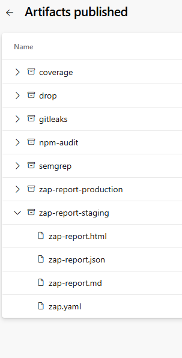

### 7.5 Interpretación y decisión

| Alerta | Decisión | Justificación |
|---|---|---|
| CSP: `style-src` `unsafe-inline` (media) | **Riesgo aceptado** | Angular 14 inserta estilos en tiempo de ejecución. `script-src` es estricto (`'self'`, sin código en línea). Eliminarlo exigiría usar nonces de CSP, lo que requiere una versión más reciente de Angular |
| `Cross-Origin-Embedder-Policy` ausente (baja) | **No aplicada** | ZAP sugiere `require-corp`, que bloquea recursos de otros dominios que no declaren permiso. La app carga imágenes desde `assets.pokemon.com`, así que podría romperse. Es una cabecera opcional y no afecta la nota A+ |
| `bypassSecurityTrustHtml` (baja) | **Falso positivo probable, pendiente de revisión** | ZAP detecta el texto en `main.<hash>.js`. En `src/` del repositorio no aparece, así que el texto procede de una dependencia empaquetada. Para cerrarlo hay que ubicar el origen en el bundle |
| Cache-Control, contenido cacheable (informativas) | **Sin acción** | `index.html` usa `no-cache`; los archivos con hash usan caché larga e `immutable`, como corresponde a recursos estáticos sin datos de usuarios. `robots.txt` y `sitemap.xml` no existen en la app, y ZAP los reporta como respuestas almacenables |

### 7.6 Correcciones típicas
- **Cabecera ausente**: agregarla en `SECURITY_HEADERS` de `src/server.js` y volver a desplegar.
- **CSP demasiado permisiva**: quitar orígenes que la app no use y repetir `verify-headers.sh`.
- **Cookies sin `Secure`, `HttpOnly` o `SameSite`**: no aplica hoy, porque la app no define cookies.
- **Alertas repetidas que ya se aceptaron**: documentarlas en este archivo. Si el equipo quiere ocultarlas del informe, ZAP permite un archivo de reglas con `-c` (no implementado hoy).

---

## 8. Riesgos aceptados y limitaciones

| Tema | Detalle |
|---|---|
| Dependencias de Angular 14 | `npm audit` en dependencias de producción: 0 críticas, 4 altas, 7 moderadas, todas ligadas a Angular 14. GitHub (Dependabot) muestra más alertas (133 al momento de la entrega) porque incluye dependencias de desarrollo. La puerta del pipeline bloquea solo las críticas de producción. Actualizar Angular está fuera del alcance de esta entrega |
| Plan F1 | Sin slots, cuota diaria de CPU y arranque en frío de uno o dos minutos. El pipeline reintenta `/healthz` hasta 12 veces, con 15 segundos de espera |
| Bypass de administrador | El ruleset deja fusionar al propietario sin aprobación, porque GitHub no permite aprobar el propio PR. Se usa de forma consciente y queda en el historial del PR |
| Tarea `NodeTool@0` obsoleta | Azure muestra una advertencia recomendando `UseNode@1`. No afecta el resultado; queda como mejora |
| Semgrep | Descarga las reglas del registro público en cada ejecución. Si el registro no está disponible, el job falla |
| Azure Pipelines en lugar de GitHub Actions | Ver la nota al inicio |
| Permisos de GitHub | Revisar y revocar al terminar la entrega las aplicaciones OAuth autorizadas que no se necesiten |

---

## 9. Lista de verificación final

**Repositorio y proceso**
- [ ] Repositorio `pokedex` en GitHub con `azure-pipelines.yml` y plantillas
- [ ] Ruleset `proteger-master` activo, con checks requeridos y sin force push
- [ ] CodeQL y Dependabot activos
- [ ] Sin credenciales ni `.patch` sueltos en el repositorio

**Pipeline**
- [ ] Ejecución de `develop` en verde
- [ ] Ejecución de `master` en verde con staging y producción
- [ ] Aprobación manual de `production` probada (captura)
- [ ] Artefactos de seguridad publicados (npm-audit, gitleaks, semgrep, ZAP)

**Aplicación**
- [ ] https://app-pokedex-monterrey-prod.azurewebsites.net abre con HTTPS válido
- [ ] `/healthz` responde `ok`
- [ ] `DISABLE_SECURITY_HEADERS` no existe en ningún ambiente
- [ ] securityheaders.com: A+ (captura)

**Documentos**
- [ ] `README.md` (cuenta de Azure) con capturas y campos completados
- [ ] `Despliegue.md` con los campos **[COMPLETAR]** resueltos
- [ ] Nombres de recursos conforme al documento del docente

---

## Anexos: contenido completo de los archivos del pipeline

### Anexo A: `azure-pipelines.yml`

```yaml
# Pipeline CI/CD de PokeDex en Azure Pipelines (repositorio en GitHub).
#
# Flujo:
#   PR a master        -> Build (lint, pruebas, build) + Seguridad. No despliega.
#   push a develop     -> Build + Seguridad + despliegue a DEV    + pruebas posteriores.
#   push a master      -> Build + Seguridad + despliegue a STAGING + pruebas posteriores (incl. ZAP)
#                         -> aprobación manual del ambiente "production" -> despliegue a PROD + pruebas.
#
# Sin secretos en el repositorio: el despliegue usa conexiones de servicio de Azure con
# federación de identidades de carga de trabajo (OIDC). No hay contraseñas ni claves guardadas.

name: $(Date:yyyyMMdd)$(Rev:.r)

trigger:
  branches:
    include:
      - master
      - develop

pr:
  branches:
    include:
      - master

pool:
  vmImage: ubuntu-24.04

variables:
  nodeVersion: '18.x'
  npm_config_cache: $(Pipeline.Workspace)/.npm
  gitleaksVersion: '8.18.4'
  semgrepVersion: '1.182.1'

stages:
  # ---------------------------------------------------------------------------
  - stage: Build
    displayName: 'CI: dependencias, lint, pruebas y build'
    jobs:
      - job: Build
        displayName: 'Build y pruebas'
        steps:
          - checkout: self
            fetchDepth: 1

          - task: NodeTool@0
            displayName: 'Instalar Node $(nodeVersion)'
            inputs:
              versionSpec: $(nodeVersion)

          - task: Cache@2
            displayName: 'Cache de npm'
            inputs:
              key: 'npm | "$(Agent.OS)" | package-lock.json'
              restoreKeys: |
                npm | "$(Agent.OS)"
              path: $(npm_config_cache)

          - script: npm ci
            displayName: 'Instalar dependencias (npm ci)'

          - script: npm run lint
            displayName: 'Lint'

          - script: |
              export CHROME_BIN="$(command -v google-chrome)"
              npm run test:cov
            displayName: 'Pruebas unitarias con cobertura (Chrome headless)'

          - script: npx ng build --configuration production
            displayName: 'Build de producción'

          - script: |
              set -e
              test -f dist/pokedex-angular/index.html
              test -f dist/pokedex-angular/server.js
              mkdir -p "$(Build.ArtifactStagingDirectory)"
              cd dist/pokedex-angular
              zip -qr "$(Build.ArtifactStagingDirectory)/app.zip" .
            displayName: 'Empaquetar app.zip'

          - publish: $(Build.ArtifactStagingDirectory)/app.zip
            artifact: drop
            displayName: 'Publicar artefacto de despliegue'

          - publish: coverage/pokedex-angular
            artifact: coverage
            displayName: 'Publicar cobertura'
            condition: succeededOrFailed()
            continueOnError: true

  # ---------------------------------------------------------------------------
  - stage: Security
    displayName: 'Seguridad previa al despliegue'
    dependsOn: []
    jobs:
      - job: DependencyAudit
        displayName: 'Dependencias (npm audit)'
        steps:
          - checkout: self
            fetchDepth: 1
          - task: NodeTool@0
            displayName: 'Instalar Node $(nodeVersion)'
            inputs:
              versionSpec: $(nodeVersion)
          - script: |
              mkdir -p "$(Build.ArtifactStagingDirectory)"
              npm audit --omit=dev --json > "$(Build.ArtifactStagingDirectory)/npm-audit.json" || true
              npm audit --omit=dev || true
            displayName: 'Informe de npm audit (dependencias de producción)'
          - script: npm audit --omit=dev --audit-level=critical
            displayName: 'Puerta: fallar si hay vulnerabilidades CRÍTICAS en producción'
          - publish: $(Build.ArtifactStagingDirectory)/npm-audit.json
            artifact: npm-audit
            displayName: 'Publicar informe de npm audit'
            condition: succeededOrFailed()
            continueOnError: true

      - job: SecretScan
        displayName: 'Escaneo de secretos (gitleaks)'
        steps:
          - checkout: self
            fetchDepth: 0
          - script: |
              set -euo pipefail
              V="$(gitleaksVersion)"
              cd "$(Agent.TempDirectory)"
              curl -sSfL -O "https://github.com/gitleaks/gitleaks/releases/download/v${V}/gitleaks_${V}_linux_x64.tar.gz"
              curl -sSfL -O "https://github.com/gitleaks/gitleaks/releases/download/v${V}/gitleaks_${V}_checksums.txt"
              sha256sum --ignore-missing -c "gitleaks_${V}_checksums.txt"
              tar xzf "gitleaks_${V}_linux_x64.tar.gz" gitleaks
              mkdir -p "$(Build.ArtifactStagingDirectory)"
              ./gitleaks detect --source "$(Build.SourcesDirectory)" --redact --no-banner --exit-code 1 \
                --report-format sarif --report-path "$(Build.ArtifactStagingDirectory)/gitleaks.sarif"
            displayName: 'gitleaks: historial completo del repositorio'
          - publish: $(Build.ArtifactStagingDirectory)/gitleaks.sarif
            artifact: gitleaks
            displayName: 'Publicar informe de gitleaks'
            condition: succeededOrFailed()
            continueOnError: true

      - job: SAST
        displayName: 'Análisis estático (Semgrep)'
        steps:
          - checkout: self
            fetchDepth: 1
          - task: UsePythonVersion@0
            displayName: 'Instalar Python'
            inputs:
              versionSpec: '3.12'
          - script: python -m pip install --quiet "semgrep==$(semgrepVersion)"
            displayName: 'Instalar Semgrep'
          - script: |
              mkdir -p "$(Build.ArtifactStagingDirectory)"
              semgrep scan --config p/javascript --config p/typescript --metrics=off --error \
                --exclude '*.spec.ts' --sarif --output "$(Build.ArtifactStagingDirectory)/semgrep.sarif" src
            displayName: 'Semgrep (reglas JavaScript y TypeScript)'
          - publish: $(Build.ArtifactStagingDirectory)/semgrep.sarif
            artifact: semgrep
            displayName: 'Publicar informe de Semgrep'
            condition: succeededOrFailed()
            continueOnError: true

  # ---------------------------------------------------------------------------
  - stage: DeployDev
    displayName: 'Despliegue a DEV (rama develop)'
    dependsOn: [Build, Security]
    condition: and(succeeded(), eq(variables['Build.SourceBranch'], 'refs/heads/develop'), ne(variables['Build.Reason'], 'PullRequest'))
    jobs:
      - template: azure-pipelines/templates/deploy-env.yml
        parameters:
          environment: dev
          serviceConnection: sc-azure-pokedex-dev
          resourceGroup: rg-pokedex-mexico-dev
          appName: app-pokedex-monterrey-dev
          runZap: false

  # ---------------------------------------------------------------------------
  - stage: DeployStaging
    displayName: 'Despliegue a STAGING (rama master)'
    dependsOn: [Build, Security]
    condition: and(succeeded(), eq(variables['Build.SourceBranch'], 'refs/heads/master'), ne(variables['Build.Reason'], 'PullRequest'))
    jobs:
      - template: azure-pipelines/templates/deploy-env.yml
        parameters:
          environment: staging
          serviceConnection: sc-azure-pokedex-stg
          resourceGroup: rg-pokedex-mexico-stg
          appName: app-pokedex-monterrey-stg
          runZap: true

  # ---------------------------------------------------------------------------
  - stage: DeployProd
    displayName: 'Despliegue a PRODUCCIÓN (aprobación manual)'
    dependsOn: DeployStaging
    condition: and(succeeded(), eq(variables['Build.SourceBranch'], 'refs/heads/master'), ne(variables['Build.Reason'], 'PullRequest'))
    jobs:
      - template: azure-pipelines/templates/deploy-env.yml
        parameters:
          environment: production
          serviceConnection: sc-azure-pokedex
          resourceGroup: rg-pokedex-mexico-prod
          appName: app-pokedex-monterrey-prod
          runZap: true
```

### Anexo B: `azure-pipelines/templates/deploy-env.yml`

```yaml
# Plantilla: despliega el artefacto "drop" en un ambiente y ejecuta las pruebas posteriores.
parameters:
  - name: environment        # Ambiente de Azure DevOps (dev | staging | production)
    type: string
  - name: serviceConnection  # Conexión de servicio de Azure (OIDC)
    type: string
  - name: resourceGroup
    type: string
  - name: appName
    type: string
  - name: runZap             # Ejecutar OWASP ZAP baseline contra la URL desplegada
    type: boolean
    default: false

jobs:
  - deployment: Deploy
    displayName: 'Desplegar en ${{ parameters.environment }}'
    environment: ${{ parameters.environment }}
    strategy:
      runOnce:
        deploy:
          steps:
            - download: current
              artifact: drop
              displayName: 'Descargar artefacto'

            - task: AzureCLI@2
              displayName: 'az webapp deploy (zip) -> ${{ parameters.appName }}'
              inputs:
                azureSubscription: ${{ parameters.serviceConnection }}
                scriptType: bash
                scriptLocation: inlineScript
                inlineScript: |
                  set -euo pipefail
                  az webapp deploy \
                    --resource-group "${{ parameters.resourceGroup }}" \
                    --name "${{ parameters.appName }}" \
                    --src-path "$(Pipeline.Workspace)/drop/app.zip" \
                    --type zip

  - job: PostDeploy
    displayName: 'Pruebas posteriores (${{ parameters.environment }})'
    dependsOn: Deploy
    steps:
      - checkout: self
        fetchDepth: 1

      - bash: bash scripts/smoke-test.sh "https://${{ parameters.appName }}.azurewebsites.net"
        displayName: 'Prueba de humo (salud y rutas)'

      - bash: bash scripts/verify-headers.sh "https://${{ parameters.appName }}.azurewebsites.net/"
        displayName: 'Verificar cabeceras de seguridad'

      - ${{ if eq(parameters.runZap, true) }}:
          - bash: |
              set +e
              URL="https://${{ parameters.appName }}.azurewebsites.net"
              OUT="$(Agent.TempDirectory)/zap"
              mkdir -p "$OUT" && chmod 777 "$OUT"
              docker run --rm -v "$OUT:/zap/wrk/:rw" ghcr.io/zaproxy/zaproxy:stable \
                zap-baseline.py -t "$URL" -r zap-report.html -J zap-report.json -w zap-report.md -m 5
              rc=$?
              echo "zap-baseline terminó con código $rc (0=sin alertas, 1=fallos, 2=advertencias, 3=error)"
              if [ "$rc" = "0" ] || [ "$rc" = "2" ]; then exit 0; fi
              exit 1
            displayName: 'OWASP ZAP baseline scan'

          - publish: $(Agent.TempDirectory)/zap
            artifact: zap-report-${{ parameters.environment }}
            displayName: 'Publicar informe de ZAP'
            condition: succeededOrFailed()
            continueOnError: true
```

### Anexo C: `scripts/smoke-test.sh`

```bash
#!/usr/bin/env bash
# Prueba de humo posterior al despliegue.
# Uso: bash scripts/smoke-test.sh <url-base> [reintentos=12] [espera_seg=15]
# El plan gratuito F1 duerme la app tras un rato sin tráfico: el primer arranque puede tardar
# uno o dos minutos, por eso se reintenta /healthz antes de dar la prueba por fallida.
set -euo pipefail

URL="${1:?Uso: smoke-test.sh <url-base> [reintentos] [espera_seg]}"
URL="${URL%/}"
RETRIES="${2:-12}"
SLEEP="${3:-15}"
FAILS=0

ok()   { echo "  [OK]    $1"; }
fail() { echo "  [FALLO] $1"; FAILS=$((FAILS + 1)); }

echo "== Esperando a que ${URL}/healthz responda 200 =="
READY=0
for i in $(seq 1 "$RETRIES"); do
  code="$(curl -s -o /dev/null -w '%{http_code}' --max-time 20 "${URL}/healthz" || true)"
  if [ "$code" = "200" ]; then READY=1; break; fi
  echo "  intento ${i}/${RETRIES}: HTTP ${code:-000}"
  sleep "$SLEEP"
done
if [ "$READY" != "1" ]; then
  echo "ERROR: la aplicación no respondió 200 en /healthz tras ${RETRIES} intentos."
  exit 1
fi
ok "/healthz responde 200"

echo "== Comprobaciones funcionales =="
home="$(curl -s --max-time 30 "${URL}/" || true)"
if echo "$home" | grep -q '<app-root'; then ok "la portada contiene <app-root>"; else fail "la portada no contiene <app-root>"; fi

code="$(curl -s -o /dev/null -w '%{http_code}' --max-time 30 "${URL}/pokemon/25" || true)"
if [ "$code" = "200" ]; then ok "ruta profunda de la SPA (/pokemon/25) devuelve 200"; else fail "ruta profunda devuelve ${code}"; fi

code="$(curl -s -o /dev/null -w '%{http_code}' --max-time 30 "${URL}/no-existe-$$.js" || true)"
if [ "$code" = "404" ]; then ok "un archivo inexistente devuelve 404"; else fail "archivo inexistente devuelve ${code} (se esperaba 404)"; fi

if [[ "$URL" == https://* ]]; then
  HTTP_URL="http://${URL#https://}"
  code="$(curl -s -o /dev/null -w '%{http_code}' --max-time 30 "${HTTP_URL}/" || true)"
  case "$code" in
    301|302|307|308) ok "HTTP redirige a HTTPS (${code})" ;;
    *) fail "HTTP no redirige a HTTPS (código ${code})" ;;
  esac
fi

if [ "$FAILS" -gt 0 ]; then
  echo "Prueba de humo FALLIDA: ${FAILS} comprobación(es)."
  exit 1
fi
echo "Prueba de humo superada."
```

### Anexo D: `scripts/verify-headers.sh`

```bash
#!/usr/bin/env bash
# Verifica las cabeceras de seguridad HTTP de una URL desplegada.
# Uso: bash scripts/verify-headers.sh <url>
set -euo pipefail

URL="${1:?Uso: verify-headers.sh <url>}"
FAILS=0

HEADERS="$(curl -sSI --max-time 30 "$URL" | tr -d '\r')"
status="$(printf '%s\n' "$HEADERS" | head -n1)"
echo "Respuesta: ${status}"

get() { printf '%s\n' "$HEADERS" | grep -i "^$1:" | head -n1 | cut -d: -f2- | sed 's/^ *//' || true; }
ok()   { echo "  [OK]    $1"; }
fail() { echo "  [FALLO] $1"; FAILS=$((FAILS + 1)); }

hsts="$(get strict-transport-security)"
if [[ "$hsts" =~ max-age=([0-9]+) ]] && [ "${BASH_REMATCH[1]}" -ge 15552000 ]; then
  ok "Strict-Transport-Security: ${hsts}"
else
  fail "Strict-Transport-Security ausente o max-age < 15552000 (valor: '${hsts}')"
fi

csp="$(get content-security-policy)"
if [ -z "$csp" ]; then
  fail "Content-Security-Policy ausente"
else
  ok "Content-Security-Policy presente"
  [[ "$csp" == *"default-src"* ]]             && ok "  CSP define default-src"                 || fail "  CSP sin default-src"
  [[ "$csp" == *"frame-ancestors 'none'"* ]]  && ok "  CSP define frame-ancestors 'none'"      || fail "  CSP sin frame-ancestors 'none'"
  [[ "$csp" == *"object-src 'none'"* ]]       && ok "  CSP define object-src 'none'"          || fail "  CSP sin object-src 'none'"
  [[ "$csp" != *"'unsafe-eval'"* ]]           && ok "  CSP sin 'unsafe-eval'"                  || fail "  CSP contiene 'unsafe-eval'"
  script_src="$(printf '%s' "$csp" | tr ';' '\n' | sed 's/^ *//' | grep '^script-src' || true)"
  [[ "$script_src" != *"'unsafe-inline'"* ]]  && ok "  script-src sin 'unsafe-inline'"         || fail "  script-src contiene 'unsafe-inline'"
fi

xcto="$(get x-content-type-options)"
[ "${xcto,,}" = "nosniff" ] && ok "X-Content-Type-Options: ${xcto}" || fail "X-Content-Type-Options debe ser nosniff (valor: '${xcto}')"

xfo="$(get x-frame-options)"
case "${xfo^^}" in
  DENY|SAMEORIGIN) ok "X-Frame-Options: ${xfo}" ;;
  *) fail "X-Frame-Options debe ser DENY o SAMEORIGIN (valor: '${xfo}')" ;;
esac

rp="$(get referrer-policy)"
case "${rp,,}" in
  no-referrer|same-origin|strict-origin|strict-origin-when-cross-origin) ok "Referrer-Policy: ${rp}" ;;
  *) fail "Referrer-Policy ausente o débil (valor: '${rp}')" ;;
esac

pp="$(get permissions-policy)"
[ -n "$pp" ] && ok "Permissions-Policy presente" || fail "Permissions-Policy ausente"

coop="$(get cross-origin-opener-policy)"
[ -n "$coop" ] && ok "Cross-Origin-Opener-Policy: ${coop}" || fail "Cross-Origin-Opener-Policy ausente"

if [ -n "$(get x-powered-by)" ]; then fail "X-Powered-By expone la tecnología del servidor"; else ok "Sin X-Powered-By"; fi

if [ "$FAILS" -gt 0 ]; then
  echo "Verificación de cabeceras FALLIDA: ${FAILS} problema(s)."
  exit 1
fi
echo "Verificación de cabeceras superada."
```
