# Cuenta de Azure para el despliegue de PokeDex: registro, verificación, MFA y control de costos

Este documento describe, paso a paso, cómo quedó configurada la cuenta de Azure usada para desplegar la aplicación **PokeDex**.

## 1. Datos generales

| Concepto | Valor |
|---|---|
| Tipo de cuenta | Azure for Students, suscripción en el tenant de la universidad: Fundación Universitaria Tecnológico Comfenalco |
| Rol sobre la suscripción | Propietario (Owner) |
| Estado de la suscripción | Activa, costo incial 0,00 |
| Organización de Azure DevOps | `wrenteriaSolutions` |
| Proyecto de Azure DevOps | `pokedex-pipeline` |
| Repositorio | https://github.com/jetbill/pokedex |
| Aplicación en producción | https://app-pokedex-monterrey-prod.azurewebsites.net |

## 2. Registro y verificación de la cuenta

1. Entrar al portal de Azure (https://portal.azure.com) con la cuenta institucional de la universidad.
2. Abrir *Suscripciones* y confirmar que **Azure for Students** aparece con estado **Activo**, rol **Propietario** y costo actual 0,00.

   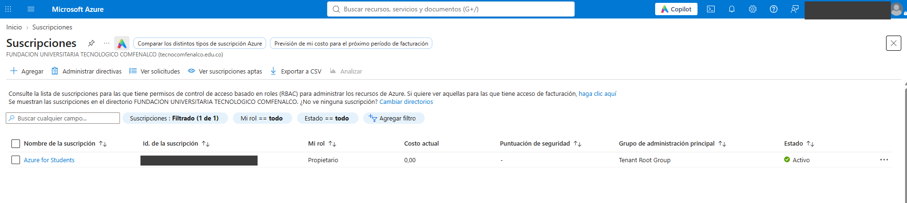

3. Revisar el crédito disponible en *Administración de costos + facturación*.
4. La cuenta Azure for Students no requiere tarjeta de crédito. Aun así, no se debe crear ningún recurso fuera del plan gratuito sin revisar su costo antes.

### Restricciones del tenant universitario encontradas

- **Microsoft Entra ID:** al abrirlo, la página carga un momento y después muestra "Sin acceso" con error 401. Es una restricción del tenant de la universidad, no un fallo de la cuenta.

  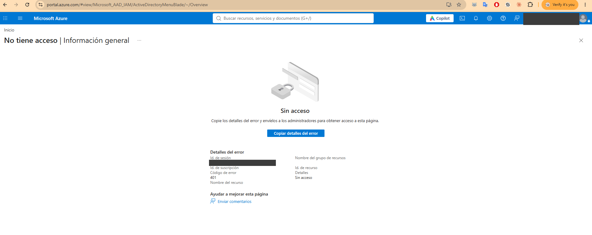

- **Política de regiones de Azure Policy:** la suscripción solo permite desplegar recursos en `francecentral`, `chilecentral`, `canadacentral`, `belgiumcentral` y `mexicocentral`. Esto impidió crear **Azure Static Web Apps** (el error fue `RequestDisallowedByAzure`), porque ese servicio no está disponible en ninguna de esas regiones. Por eso el despliegue usa **Azure App Service (Linux, plan F1 gratuito)** en `mexicocentral`.

  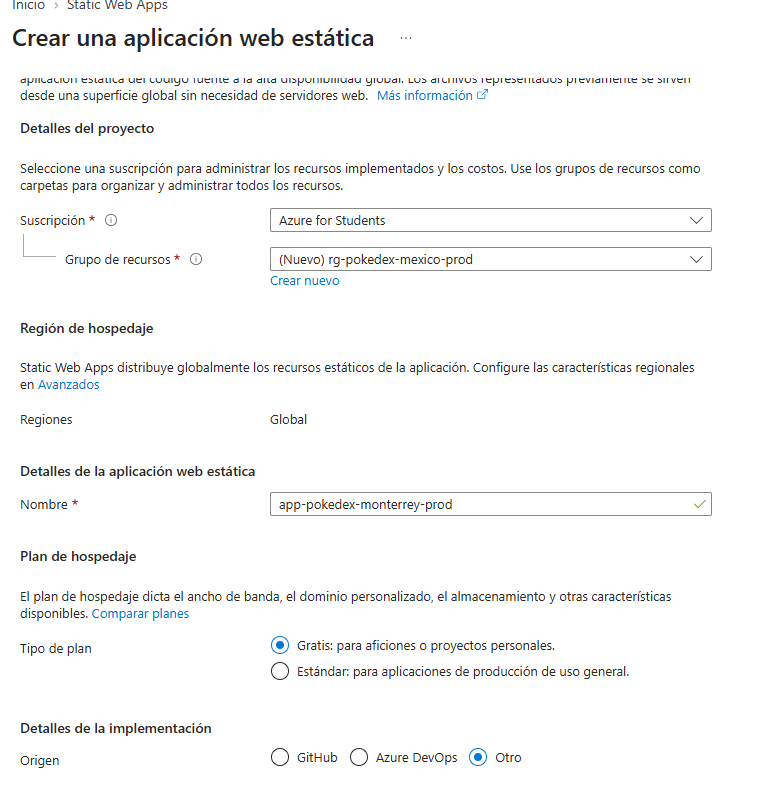

## 3. Autenticación multifactor (MFA)

Como el panel de Entra ID está bloqueado, el método de autenticación se registró desde el portal personal de seguridad de Microsoft:

1. Abrir https://mysignins.microsoft.com con la cuenta institucional. Ahí se ve la actividad reciente de inicios de sesión de la cuenta.

   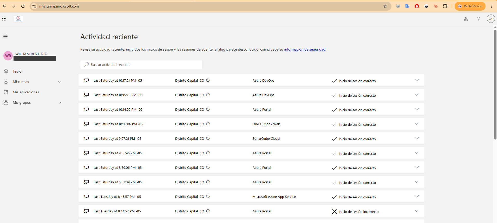

2. Entrar a **Información de seguridad** y elegir **Agregar método de inicio de sesión**, luego **Microsoft Authenticator**. Instalar la aplicación en el teléfono y seguir el asistente.
3. Al terminar, el asistente confirma "Authenticator Added" y lo deja como método de inicio de sesión predeterminado.

   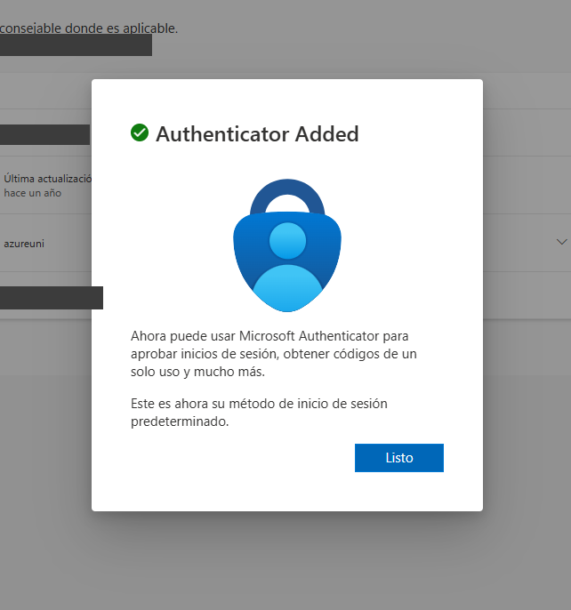

4. Cerrar sesión y volver a entrar: Microsoft pide aprobar el inicio de sesión en la aplicación, escribiendo el número que muestra la pantalla.

   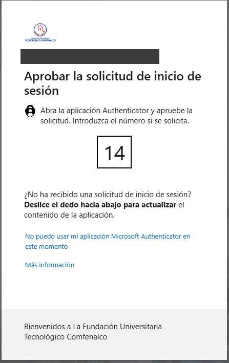

Resultado: el inicio de sesión en Azure y en Azure DevOps exige un segundo factor.

## 4. Presupuesto y alertas de costo

Aunque los recursos del proyecto son gratuitos (plan F1), se configuró un presupuesto como red de seguridad:

| Campo | Valor |
|---|---|
| Nombre | `presupuesto-pokedex` |
| Ámbito | Cuenta de facturación del autor |
| Período de restablecimiento | Mensual |
| Vigencia | 1 oct 2026 a 30 nov 2026 |
| Importe | US$ 10 |
| Alertas | Costo real al 50 % (US$ 5), al 80 % (US$ 8) y al 100 % (US$ 10); costo previsto al 100 % (US$ 10) |
| Destinatario | Correo institucional del autor |

Pasos: **Administración de costos + facturación → Presupuestos → Agregar**.

1. Definir el nombre, el período, las fechas y el importe.

   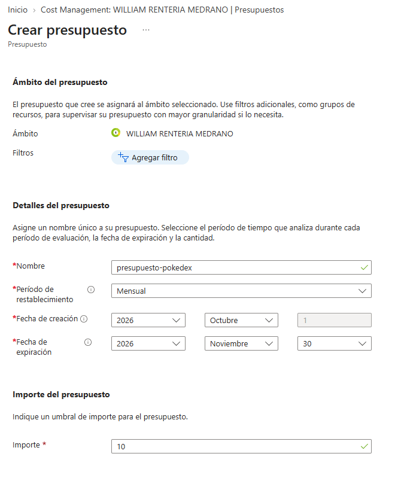

2. Configurar las condiciones de alerta y el correo que las recibe.

   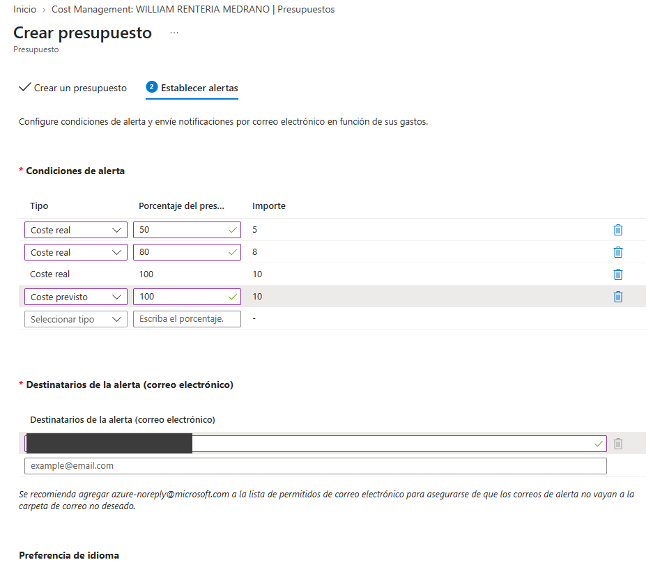

3. Confirmar que el presupuesto aparece en la lista, con gasto evaluado de 0,00.

   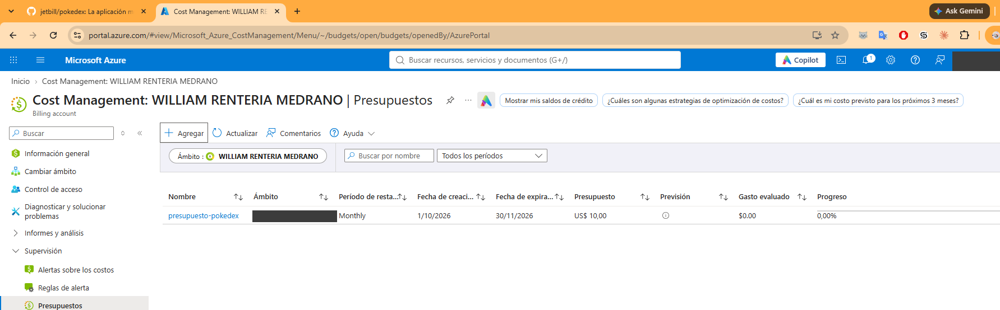

> Los presupuestos de Azure **avisan, pero no detienen** el gasto. Por eso se revisa en *Análisis de costos* que los recursos creados sigan en el plan gratuito. El presupuesto vence el 30 de noviembre de 2026.

## 5. Recursos creados y su costo esperado

| Recurso | Nombre | SKU | Costo |
|---|---|---|---|
| Grupos de recursos | `rg-pokedex-mexico-prod`, `-stg`, `-dev` | — | Sin costo |
| Planes de App Service | `asp-pokedex-mexico-prod`, `-stg`, `-dev` | F1 (Linux) | Gratuito |
| Aplicaciones web | `app-pokedex-monterrey-prod`, `-stg`, `-dev` | Node 22 LTS | Gratuito en F1 |

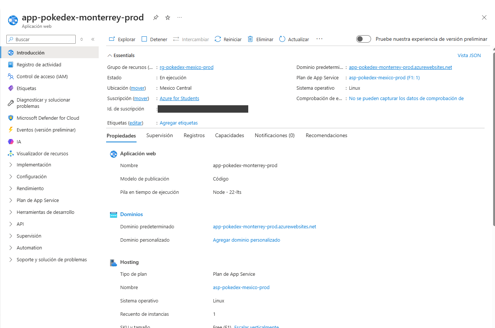

El plan F1 tiene una cuota diaria de CPU y la aplicación se duerme tras un rato sin tráfico, así que la primera petición puede tardar uno o dos minutos. No hay slots de despliegue en F1.

## 6. Azure DevOps: minutos gratuitos

Azure DevOps ofrece agentes alojados por Microsoft gratis solo en **proyectos privados** (1 trabajo paralelo, hasta 1800 minutos al mes). En proyectos públicos la cuota de agentes de Microsoft es 0. Por eso el proyecto `pokedex-pipeline` debe ser **Privado**, aunque el repositorio de GitHub sea público.

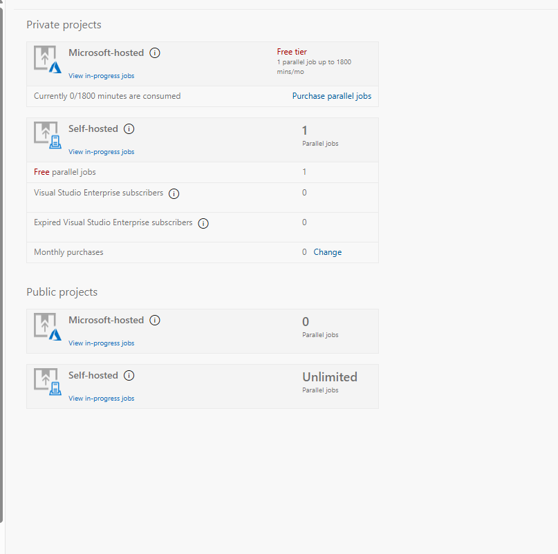

## 7. Acceso desde el pipeline sin contraseñas

El pipeline de Azure DevOps no guarda ninguna credencial. Se crearon **conexiones de servicio** de tipo Azure Resource Manager con **federación de identidades de carga de trabajo (OIDC)**, cada una limitada a un solo grupo de recursos:

| Conexión de servicio | Grupo de recursos |
|---|---|
| `sc-azure-pokedex-dev` | `rg-pokedex-mexico-dev` |
| `sc-azure-pokedex-stg` | `rg-pokedex-mexico-stg` |
| `sc-azure-pokedex` | `rg-pokedex-mexico-prod` |

1. **Project settings → Service connections → New service connection → Azure Resource Manager.**

   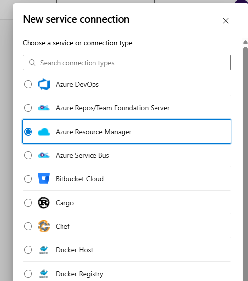

2. Elegir *App registration (automatic)*, credencial *Workload identity federation*, la suscripción, el **grupo de recursos** (para limitar el acceso) y el nombre. Dejar sin marcar "Grant access permission to all pipelines".

   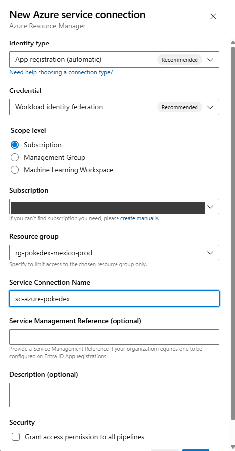

3. La conexión queda creada con federación OpenID Connect, sin secretos.

   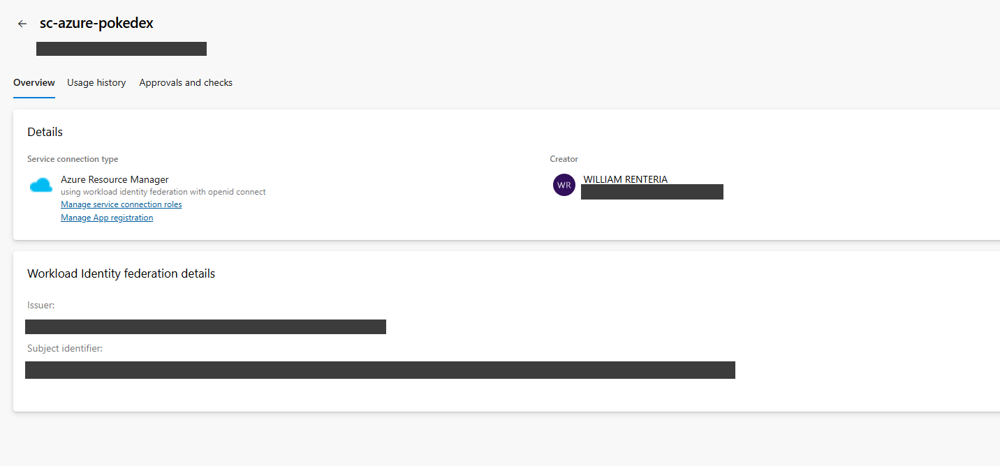

### Autorización de GitHub
Al crear el pipeline, Azure Pipelines pide autorizar su aplicación OAuth en GitHub. Se autorizó solo lo necesario para el repositorio `jetbill/pokedex`, sin solicitar acceso a organizaciones adicionales. Al terminar la entrega conviene revisar y revocar los permisos que ya no se usen.

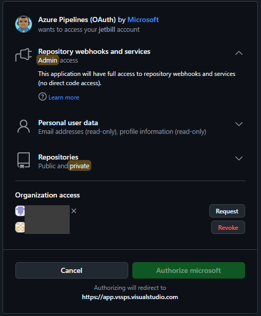

## 8. Lista de verificación de la cuenta

- [ ] Suscripción Azure for Students activa y rol Propietario
- [ ] Crédito y vencimiento anotados
- [ ] MFA con Microsoft Authenticator registrado y probado
- [ ] Presupuesto `presupuesto-pokedex` con alertas al 50 %, 80 % y 100 %
- [ ] Todos los recursos en SKU gratuito (F1)
- [ ] Proyecto de Azure DevOps en modo Privado
- [ ] Conexiones de servicio con OIDC y alcance limitado a un grupo de recursos
- [ ] Ninguna contraseña, clave ni identificador sensible en el repositorio
